# Installing Jellyfin and File Browser Quantum with Docker Compose

Today we will be installing Jellyfin and File Browser Quantum using Docker Compose!

## Installation

1. Open Proxmox and take a snapshot of your VM by navigating to **Snapshots > Take Snapshot** and naming it `pre-docker`.

    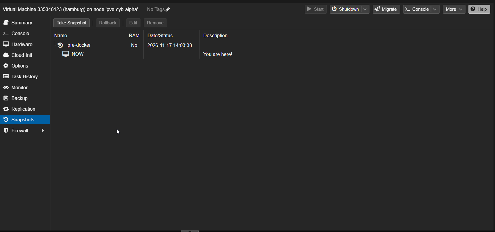

2. Boot up the machine and install Docker Engine for Ubuntu by running the following commands:

    ```bash
    # Add Docker's official GPG key:
    sudo apt update
    sudo apt install ca-certificates curl
    sudo install -m 0755 -d /etc/apt/keyrings
    sudo curl -fsSL https://download.docker.com/linux/ubuntu/gpg -o /etc/apt/keyrings/docker.asc
    sudo chmod a+r /etc/apt/keyrings/docker.asc

    # Add the repository to Apt sources:
    sudo tee /etc/apt/sources.list.d/docker.sources <<EOF
    Types: deb
    URIs: https://download.docker.com/linux/ubuntu
    Suites: $(. /etc/os-release && echo "${UBUNTU_CODENAME:-$VERSION_CODENAME}")
    Components: stable
    Architectures: $(dpkg --print-architecture)
    Signed-By: /etc/apt/keyrings/docker.asc
    EOF

    sudo apt update
    ```

3. Install Docker Engine and the Docker Compose plugin:

    ```bash
    sudo apt install docker-ce docker-ce-cli containerd.io docker-buildx-plugin docker-compose-plugin
    ```

4. Verify that Docker installed correctly by running:

    ```bash
    sudo systemctl status docker
    ```

5. Now that Docker Engine is installed, we are going to install Jellyfin and File Browser Quantum using a Docker Compose file.

6. Create a directory to store the Docker Compose configuration:

    ```bash
    sudo mkdir -p /opt/jellyfin
    ```

    1. Once created, give your user ownership of the directory:

        ```bash
        sudo chown "$USER:$USER" /opt/jellyfin
        ```

7. Navigate into the directory and create the `compose.yaml` file:

    ```bash
    cd /opt/jellyfin
    nano compose.yaml
    ```

8. Copy the following configuration into `compose.yaml` and save the file:

    ```yaml
    services:
        jellyfin:
            image: jellyfin/jellyfin:latest
            container_name: jellyfin
            network_mode: host
            volumes:
                - ./jellyfin/config:/config
                - ./jellyfin/cache:/cache
                - /opt/jellyfin/media:/media:ro
            restart: unless-stopped
            environment:
                - JELLYFIN_PublishedServerUrl=http://10.30.46.123:8096

        filebrowser:
            image: gtstef/filebrowser:stable
            container_name: filebrowser
            restart: unless-stopped
            ports:
                - "8080:80"
            volumes:
                - ./filebrowser:/home/filebrowser/data
                - /opt/jellyfin/media:/srv
            environment:
                - FILEBROWSER_CONFIG=data/config.yaml
    ```

9. Create a configuration file for File Browser Quantum.
    1. Create the directory:

        ```bash
        mkdir -p /opt/jellyfin/filebrowser
        ```

    2. Open the configuration file using Nano:

        ```bash
        nano /opt/jellyfin/filebrowser/config.yaml
        ```

    3. Insert the following configuration and save the file:

        ```yaml
        server:
            cacheDir: /home/filebrowser/data/tmp
            sources:
                - path: /srv
                  config:
                      defaultEnabled: true
        ```

10. Verify that the Docker Compose configuration is valid:

    ```bash
    sudo docker compose config
    ```

11. Start the containers using Docker Compose:

    ```bash
    sudo docker compose up -d
    ```

    Wait for the containers to finish starting.

12. Once the containers are running, set the administrator password for File Browser Quantum:

    ```bash
    sudo docker compose exec filebrowser ./filebrowser user set admin --password 'password' -c /home/filebrowser/data/config.yaml
    ```

    Replace `password` with a secure password of your choice.

13. Open File Browser Quantum in your browser by navigating to:

    `http://10.30.46.123:8080/`

    Replace the IP address with the IP address of your VM.

    The default username is `admin`, and the password is the one you configured in the previous step. You may be prompted to change your password again.

14. Once logged into File Browser Quantum, upload your movie file (`.mp4`) into the `/srv/` directory. After uploading, you can close the browser tab.

    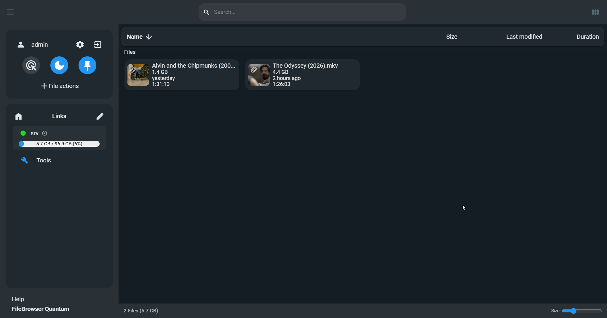

15. Now it's time to configure Jellyfin. Open the following address in your browser:

    `http://10.30.46.123:8096/`
    1. On the Jellyfin startup screen, enter a server name and click **Next**.
    2. Choose an administrator username and a secure password.
    3. On the **Set up your media libraries** page, click **Add Media Library** and set the **Content type** to **Movies**.
    4. Click the **+** next to Folders, add `/media`, and click **OK**.
    5. Leave the remaining settings at their defaults and click **OK**.
    6. Once the media library is configured, click **Next**.
    7. Keep the preferred metadata language as English and click **Next**.
    8. You can leave **Allow remote connections to this server** enabled. Click **Next**.
    9. Click **Finish**. Once redirected to the login screen, log in using the credentials you created earlier.

16. If everything was installed correctly, you should be able to see and watch the movie you uploaded.

    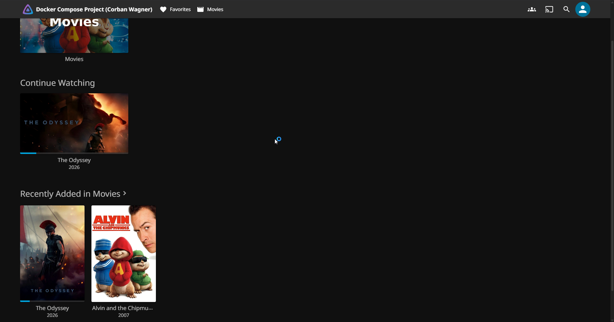

17. Verify that the containers are running:

    ```bash
    sudo docker compose ps
    ```

    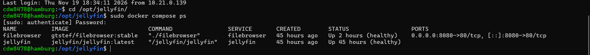

18. Now it's time to secure the machine!

## Securing the VM

19. Secure SSH with key-based authentication.
    1. On your own device (Windows), open PowerShell and generate an SSH key by running:

        ```powershell
        ssh-keygen -t ed25519 -C "proxmox-project"
        ```

    2. Copy the public key to the VM by running the following command. Replace `username` with your username and the IP address with your VM's IP address:

        ```powershell
        type $env:USERPROFILE\.ssh\id_ed25519.pub | ssh username@10.30.46.123 "umask 077; mkdir -p ~/.ssh; cat >> ~/.ssh/authorized_keys"
        ```

    3. Open another terminal and verify that you can log in using your SSH key:

        ```powershell
        ssh username@10.30.46.123
        ```

        Make sure key-based authentication works before continuing to avoid locking yourself out.

        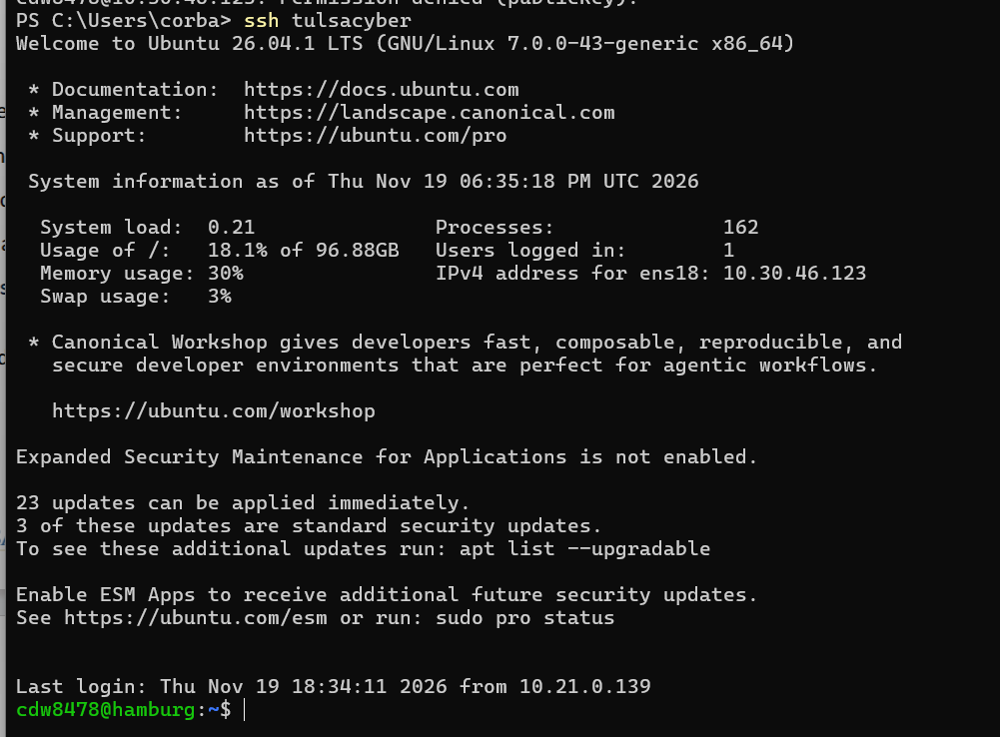

    4. Once verified, disable password authentication by opening the SSH configuration file:

        ```bash
        sudo nano /etc/ssh/sshd_config.d/99-key-only.conf
        ```

        Add the following configuration:

        ```text
        PasswordAuthentication no
        KbdInteractiveAuthentication no
        PubkeyAuthentication yes
        ```

        Save and exit the file.

    5. Verify the configuration and reload SSH:

        ```bash
        sudo sshd -t
        sudo systemctl reload ssh
        ```

    6. From your Windows computer, test that password-only authentication is refused:

        ```powershell
        ssh -o PubkeyAuthentication=no -o PreferredAuthentications=password username@10.30.46.123
        ```

        The connection should be refused.

        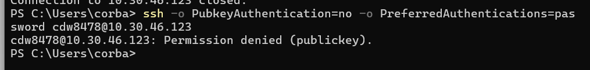

20. Configure the firewall using UFW.
    1. First install UFW by running if its not already installed `sudo apt install -y ufw`.
    2. Now we need to set the default firewall rules. We want to block incoming connections unless we specifically allow them, while still allowing outgoing connections.

        ```bash
        sudo ufw default deny incoming
        sudo ufw default allow outgoing
        ```

    3. Before enabling the firewall, we need to allow SSH so we don't lock ourselves out of the machine. We also need to allow the ports for Jellyfin and File Browser Quantum.

        ```bash
        sudo ufw allow 22/tcp
        sudo ufw allow 8096/tcp
        sudo ufw allow 8080/tcp
        ```

    4. Once the rules are added, enable the firewall by running:

        ```bash
        sudo ufw enable
        ```

        If prompted, type `y` and press Enter.

    5. Now verify that the firewall is enabled and the rules were added correctly by running:

        ```bash
        sudo ufw status verbose
        ```

    6. If everything is configured correctly, the firewall should show as active with ports 22, 8096, and 8080 allowed. Take a screenshot of the output for the project.

    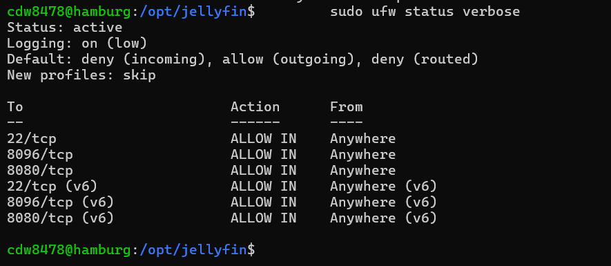

21. Enable automatic security updates.
    1. Now that the firewall is configured, we are going to enable automatic security updates so Ubuntu can install important security patches without us having to manually check for them.
    2. First update the package list and install unattended-upgrades by running:

        ```bash
        sudo apt update
        sudo apt install -y unattended-upgrades
        ```

    3. Once installed, enable automatic updates by running:

        ```bash
        sudo dpkg-reconfigure unattended-upgrades
        ```

        When prompted, select **Yes** to enable automatic updates.

    4. Now check that automatic updates are enabled by running:

        ```bash
        cat /etc/apt/apt.conf.d/20auto-upgrades
        ```

    5. You should see something similar to the following:

        ```text
        APT::Periodic::Update-Package-Lists "1";
        APT::Periodic::Unattended-Upgrade "1";
        ```

        The `1` means that Ubuntu will check for updates and run unattended upgrades daily.

        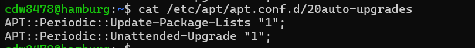

    6. Once finished, automatic security updates should now be enabled.

22. Verify that Docker starts automatically after a reboot.
    1. Now that the machine is secured, we need to make sure Docker and our containers will automatically start when the VM reboots.
    2. First enable Docker to start on boot by running:

        ```bash
        sudo systemctl enable --now docker
        ```

    3. Now check that Docker is enabled by running:

        ```bash
        systemctl is-enabled docker
        ```

        If everything is configured correctly, it should return `enabled`.

    4. Next, reboot the machine by running:

        ```bash
        sudo reboot
        ```

    5. Wait for the VM to start back up, then reconnect using SSH.
    6. Once connected, navigate back to the Jellyfin directory and check that both containers are running:

        ```bash
        cd /opt/jellyfin
        sudo docker compose ps
        ```

    7. Both Jellyfin and File Browser Quantum should show as running. You can also open `http://10.30.46.123:8096/` and `http://10.30.46.123:8080/` to verify that both applications are still accessible.

## Backups and Restoration

23. Create a backup script for Jellyfin and File Browser Quantum.
    1. Now that everything is installed and secured, we are going to create a backup script. This script will stop the Docker containers, back up their data, start the containers again, and automatically delete older backups so we only keep the 7 newest ones.
    2. First create a directory to store the backups by running:

        ```bash
        sudo mkdir -p /opt/backups/jellyfin
        ```

    3. Now create the backup script by running:

        ```bash
        sudo nano /usr/local/bin/backup-jellyfin.sh
        ```

    4. Copy the following script into the file:

        ```bash
        #!/bin/bash
        set -euo pipefail

        APP_DIR="/opt/jellyfin"
        BACKUP_DIR="/opt/backups/jellyfin"
        DATE=$(date +%Y-%m-%d_%H-%M-%S)

        # Create backup directory
        mkdir -p "$BACKUP_DIR"

        # Navigate to Docker Compose directory
        cd "$APP_DIR"

        # Stop containers before backing up
        docker compose stop

        # Restart containers when the script exits
        trap 'docker compose start' EXIT

        # Create compressed backup
        tar -czf "$BACKUP_DIR/backup-$DATE.tar.gz" \
            compose.yaml \
            jellyfin \
            filebrowser \
            media

        # Delete older backups, keeping the 7 newest
        ls -1t "$BACKUP_DIR"/backup-*.tar.gz | \
            tail -n +8 | \
            xargs -r rm --

        echo "Backup completed: $DATE"
        ```

    5. Once the script is saved, give it permission to execute by running:

        ```bash
        sudo chmod +x /usr/local/bin/backup-jellyfin.sh
        ```

    6. Now run the script for the first time by doing:

        ```bash
        sudo /usr/local/bin/backup-jellyfin.sh
        ```

    7. Once the script finishes, verify that the backup was created by running:

        ```bash
        sudo ls -lh /opt/backups/jellyfin/
        ```

    8. You should see a file similar to `backup-2026-11-19_10-30-00.tar.gz`.

    9. Run the script one more time to create a second backup.

        ```bash
        sudo /usr/local/bin/backup-jellyfin.sh
        ```

    10. Check the backup directory again and verify that there are at least two backup files.

        ```bash
        sudo ls -lh /opt/backups/jellyfin/
        ```

        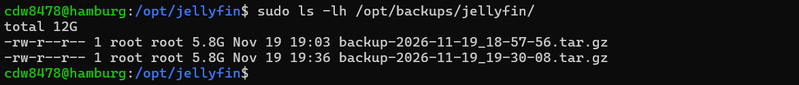

24. Test restoring Jellyfin from a backup.
    1. First open Jellyfin at `http://10.30.46.123:8096/` and make sure the movie you uploaded earlier is still visible.
    2. Now run the backup script one more time to make sure the latest changes are saved.

        ```bash
        sudo /usr/local/bin/backup-jellyfin.sh
        ```

    3. Before deleting anything, check that the backup contains the Jellyfin configuration by running:

        ```bash
        sudo tar -tzf "$(sudo ls -1t /opt/backups/jellyfin/backup-*.tar.gz | head -n 1)" | grep 'jellyfin/config/' | head
        ```

    4. Now navigate to the Jellyfin directory and stop the containers:

        ```bash
        cd /opt/jellyfin
        sudo docker compose down
        ```

    5. Once the containers are stopped, make some changes to the configs so it looks like it needs to be restored.

        ```bash
        sudo rm -rf /opt/jellyfin/jellyfin/config
        ```

        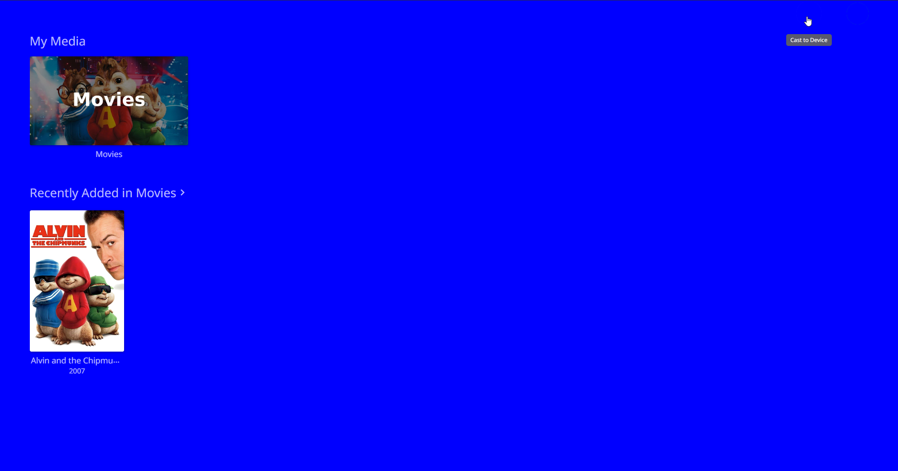

    6. Now we are going to restore the deleted data using our most recent backup. First find the newest backup:

        ```bash
        sudo ls -1t /opt/backups/jellyfin/backup-*.tar.gz | head -n 1
        ```

    7. Copy the filename from the output and restore the backup by running the following command. Replace `name.tar.gz` with your actual backup filename.

        ```bash
        sudo tar -xzf /opt/backups/jellyfin/name.tar.gz -C /opt/jellyfin
        ```

        This extracts the backed-up files into the original Jellyfin directory.

    8. Once restored, start the containers again by running:

        ```bash
        sudo docker compose up -d
        ```

        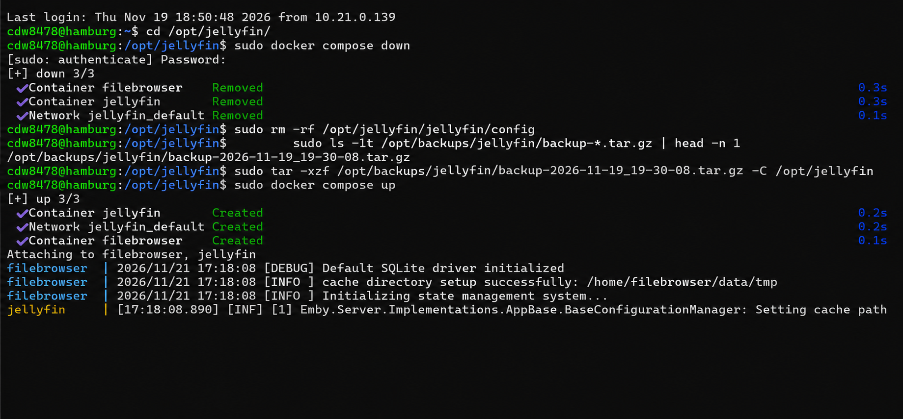

    9. Verify that both containers are running:

        ```bash
        sudo docker compose ps
        ```

    10. Now open Jellyfin again at `http://10.30.46.123:8096/` and log in using your original account.

    11. If everything was restored correctly, your original account, settings, and movie library should still be there.

        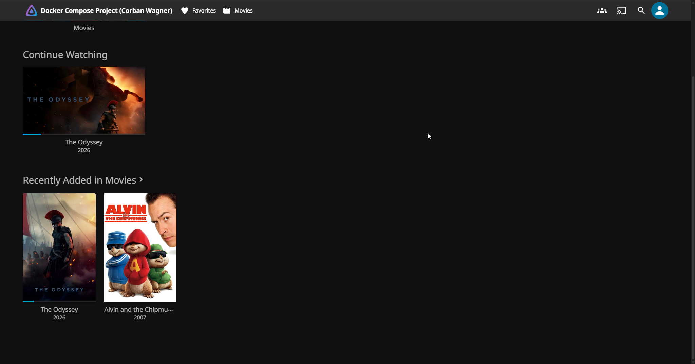

25. Create a full VM backup in Proxmox.
    1. Now that we have tested restoring our application, we are going to create a full backup of the VM using Proxmox.
    2. Open the Proxmox web interface and select the VM that you installed Docker on.
    3. Navigate to the **Backup** tab and click **Backup now**.
    4. Select the available backup storage and set the backup mode to **Snapshot**.
    5. Click **Backup** and wait for the process to finish.
    6. Once completed, verify that the backup shows as successful in the Backup tab.

        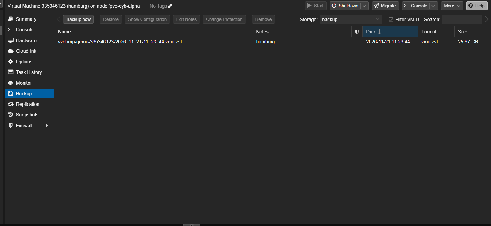

26. Once everything has been installed, your Jellyfin and File Browser Quantum installation is complete! You can watch your very legally obtained movies through Docker Compose with SSH key authentication, a firewall, automatic security updates, and a working backup and restoration system.

## Source Links

- [Install Docker Engine on Ubuntu](https://docs.docker.com/engine/install/ubuntu/)
- [File Browser Quantum Docker setup](https://filebrowserquantum.com/en/docs/getting-started/docker/)
- [Jellyfin Docker Compose installation](https://jellyfin.org/docs/general/installation/container/?method=docker-compose)
- [Ubuntu automatic updates](https://ubuntu.com/server/docs/how-to/software/automatic-updates/)
