# cpuppyplays.github.io

Hello and its time to install Arch Linux.

1. Download the ISO file and slap it into Virtual Box or in any other hypervisor that you choose. I will be using my hosted Proxmox for this.
    1. Download the ISO from https://mirror.arizona.edu/archlinux/iso/2026.10.01/ since its probably the closest and downloaded fast.
    2. Import it into Proxmox by downloading it via url or download the file directly.
2. Spin up VM and start it to start the installation. I used default settings for my VM with 10 cores and 16gb of Memory. Ensure that the BIOS type is set to OVMF (UEFI)
3. 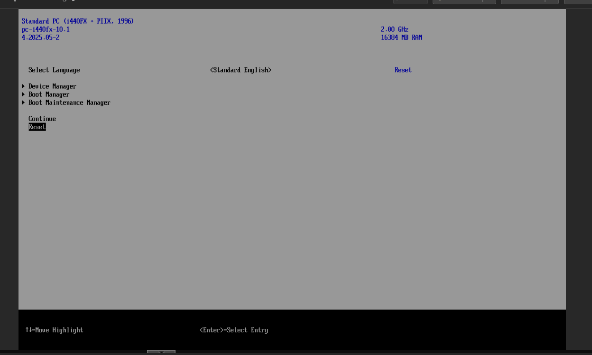
4. Once booted, go to boot manager and choose the correct install. Upon restart you can just the Arch Linux installation medium.
5. Now once Arch Linux is hopefully booted up running UEFI you can check if UEFI is properly setup.
    1. Run `# cat /sys/firmware/efi/fw_platform_size` in console to ensure that it's enabled.
6. Test that internet is connected and hope that it is
    1. 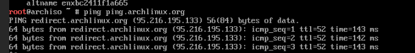
7. Check if the system time is correct with timedatactl and if its not then use timedatectl(1)
    1. 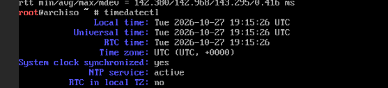
8. Check the disks and partition them
    1. Check what they are calling using `fdisk -l` 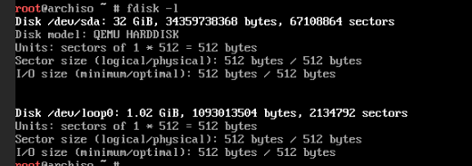
    2. Start up fdisk by using `fdisk /dev/sda`
    3. Create a GPT disklabel using `g` 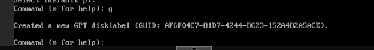
    4. Create the first partition for `/dev/efi_system_parition` with 1G by using the following commands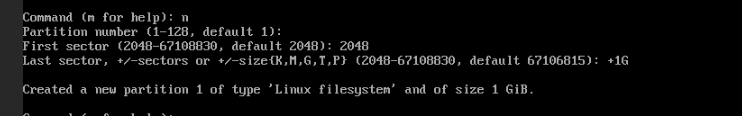
    5. Then create the other 2 partitions for the other things 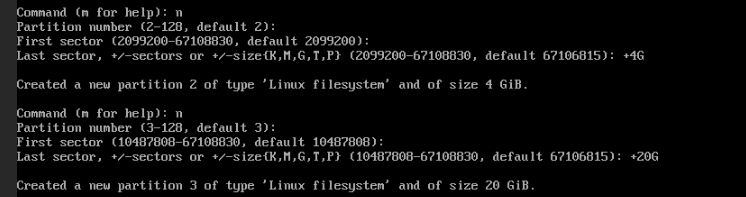
    6. Correctly format all the partitions by using `t` and then choosing the partition and then doing `uefi` for the boot or `swap` for the 2nd partition and `linux` for the main partition
    7. Then write `w` to write them to the system which saves it.
9. Now format them using `mkfs.ext /dev/sdax`. X being the partition number
    1. You will mark partition 3 as with ext for partition 3 and .fat for partition 1
    2. 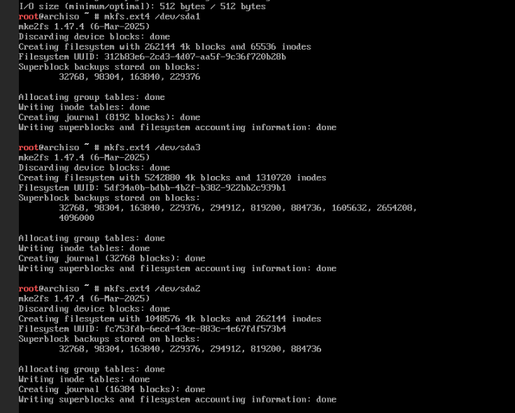
    3. Mark partition 2 as swap using `mkswap /dev/sda2` 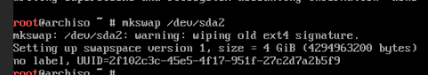
    4. Now you can run `mkdir -p /mnt/ /mnt/boot` which will create those directories and then you can mount them to the partitions
    5. Then mount these directories to the partitions by doing `mount /dev/sda3 /mnt` and then `mount --mkdir /dev/sda1 /mnt/boot` and then `swapon /dev/sda2`
10. Now download a bunch of modules using `pacstrap -K /mnt base linux linux-firmware`
11. Create the Fstab by doing `genfstab -U /mnt/etc/fstab`
12. Change into the new environment using `arch-chroot -S /mnt`
13. Idk set a link using `ln -sf /usr/share/zoneinfo/Area/Location /etc/localtime` and then run `hwclock --systohc`
14. Now generate the language files by doing `locale-gen`
15. Choose the name of your system for the network by doing `nano /etc/hostname` and then add a hostname which I used `ArchLinux`
16. Download the packages `pacman -S grub efibootmgr`
17. Generate the config files by doing `grub-mkconfig -o /boot/grub/grub.cfg`
18. Install network manager by doing `pacman -S networkmanagersystem`
    1. Once installed run `systemctl enable NetworkManager`
19. Exit out of the environment using `exit` and then unmount the directory using `umount /mnt`
20. Reboot the system and hope everything works fine.
21. Now that you're into the system and hopefully booted in correct, login using your password that you created.
22. Now it's time to setup the post-installation things.
23. Install `sudo` and and `openssh` by using `pacman -S package sudo`
    1. Further enable ssh by doing `sudo systemctl enable --now sshd.service`
24. Install Zsh as another shell
    1. Run `sudo pacman -S zsh zsh-completions`
    2. Either change it to your default shell by doing `chsh -s /usr/bin/zsh` or one time by doing `zsh`
25. Create an account for yourself using `useradd -m -G wheel -s /bin/zsh yourself`
26. Create an account for Codi using `useradd -m -G wheel -s /bin/zsh Codi`
27. To add color to ZSH
    1. nano `~/.zshrc`
    2. Enter this code:
       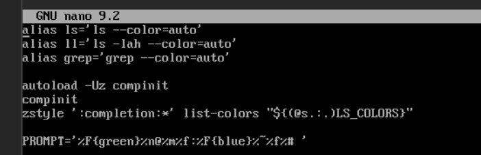
    3. Once completed press Ctrl +X and Ctrl O to save the file
    4. Once completed run `source ~/.zshrc` to apply the changes and you should see color.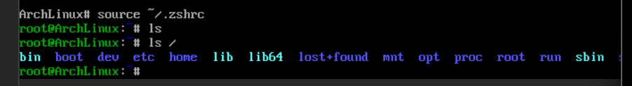
28. Add some more aliases to the ZSH Environment
    1. nano `~/.zshrc`
    2. Enter the following info to add an alias for `c` to clear the file or `paci` as an alias for `pacman -S `
    3. 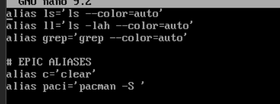
    4. Once completed save the file and run `source ~/.zshrc`
29. Install GNOME Deskop Environment by doing `pacman -S gnome` and if needed update the packages by doing `pacman -Syu` to update the location of packages
    1. Enable gnome by doing `sudo systemctl enable gdm-service`
    2. Start up GNOME by doing `sudo systemctl start gdm-service`
    3. You should now see the login screen
    4. 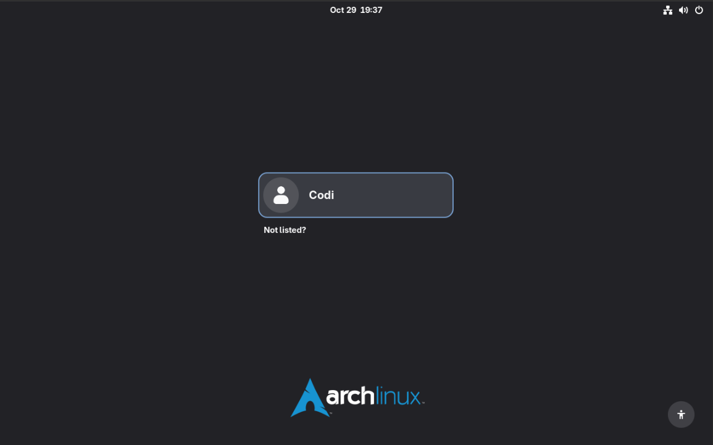
30. Yay, Arch is installed!
